# Poly Haven: Coast & Water HDRIs

**71 assets from [Poly Haven](https://polyhaven.com), dedicated to the public domain under [CC0](https://polyhaven.com/license).** Use them in any game, free or paid, and change them however you like; no credit is needed.

HDRI skies and environments as 1K and 2K Radiance `.hdr` images, for lighting and backgrounds. 566.2 MB in all.

This is a copy kept by [zuujis-cc0](https://github.com/zuujis-cc0) so game makers can take single files from GitHub. It is not made by or affiliated with Poly Haven: the originals, in more formats and higher resolutions, are on [polyhaven.com](https://polyhaven.com). If they help you, consider [supporting Poly Haven](https://www.patreon.com/polyhaven/overview).

Every file is listed in [MANIFEST.tsv](MANIFEST.tsv) with its size and SHA-256. More free assets: [the collection](https://github.com/zuujis-cc0/free-game-assets#readme).

| | | | |
| :-: | :-: | :-: | :-: |
| <a href="arboretum">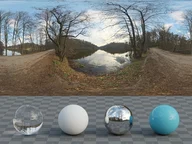</a> <b><a href="arboretum">Arboretum</a></b> by Sergej Majboroda · <a href="https://polyhaven.com/a/arboretum">source</a> | <a href="aristea_wreck">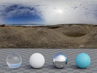</a> <b><a href="aristea_wreck">Aristea Wreck</a></b> by Greg Zaal · <a href="https://polyhaven.com/a/aristea_wreck">source</a> | <a href="bell_park_pier">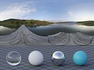</a> <b><a href="bell_park_pier">Bell Park Pier</a></b> by Greg Zaal · <a href="https://polyhaven.com/a/bell_park_pier">source</a> | <a href="blau_river">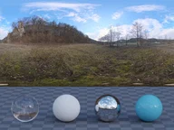</a> <b><a href="blau_river">Blau River</a></b> by Andreas Mischok · <a href="https://polyhaven.com/a/blau_river">source</a> |
| <a href="blouberg_sunrise_1">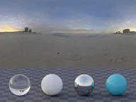</a> <b><a href="blouberg_sunrise_1">Blouberg Sunrise 1</a></b> by Greg Zaal, Rico Cilliers · <a href="https://polyhaven.com/a/blouberg_sunrise_1">source</a> | <a href="blouberg_sunrise_2">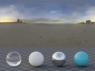</a> <b><a href="blouberg_sunrise_2">Blouberg Sunrise 2</a></b> by Greg Zaal, Rico Cilliers · <a href="https://polyhaven.com/a/blouberg_sunrise_2">source</a> | <a href="blue_lagoon">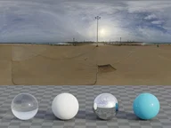</a> <b><a href="blue_lagoon">Blue Lagoon</a></b> by Greg Zaal · <a href="https://polyhaven.com/a/blue_lagoon">source</a> | <a href="blue_lagoon_night">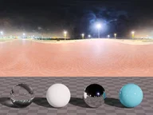</a> <b><a href="blue_lagoon_night">Blue Lagoon Night</a></b> by Greg Zaal · <a href="https://polyhaven.com/a/blue_lagoon_night">source</a> |
| <a href="cannon">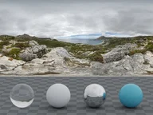</a> <b><a href="cannon">Cannon</a></b> by Greg Zaal · <a href="https://polyhaven.com/a/cannon">source</a> | <a href="cape_hill">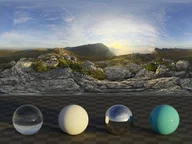</a> <b><a href="cape_hill">Cape Hill</a></b> by Greg Zaal, Rico Cilliers · <a href="https://polyhaven.com/a/cape_hill">source</a> | <a href="cloudy_cliffside_road">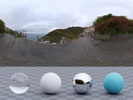</a> <b><a href="cloudy_cliffside_road">Cloudy Cliffside Road</a></b> by Greg Zaal, Rico Cilliers · <a href="https://polyhaven.com/a/cloudy_cliffside_road">source</a> | <a href="crystal_falls">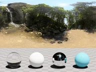</a> <b><a href="crystal_falls">Crystal Falls</a></b> by Greg Zaal · <a href="https://polyhaven.com/a/crystal_falls">source</a> |
| <a href="dam_wall">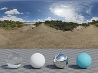</a> <b><a href="dam_wall">Dam Wall</a></b> by Dimitrios Savva, Jarod Guest · <a href="https://polyhaven.com/a/dam_wall">source</a> | <a href="docklands_01">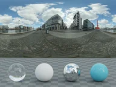</a> <b><a href="docklands_01">Docklands 01</a></b> by Savva Zakharov · <a href="https://polyhaven.com/a/docklands_01">source</a> | <a href="docklands_02">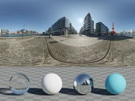</a> <b><a href="docklands_02">Docklands 02</a></b> by Savva Zakharov · <a href="https://polyhaven.com/a/docklands_02">source</a> | <a href="dresden_moat">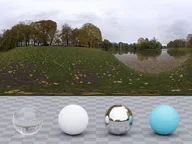</a> <b><a href="dresden_moat">Dresden Moat</a></b> by Greg Zaal · <a href="https://polyhaven.com/a/dresden_moat">source</a> |
| <a href="fish_hoek_beach">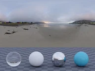</a> <b><a href="fish_hoek_beach">Fish Hoek Beach</a></b> by Greg Zaal, Rico Cilliers · <a href="https://polyhaven.com/a/fish_hoek_beach">source</a> | <a href="frozen_lake">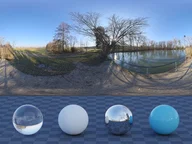</a> <b><a href="frozen_lake">Frozen Lake</a></b> by Alexander Scholten · <a href="https://polyhaven.com/a/frozen_lake">source</a> | <a href="furry_clouds">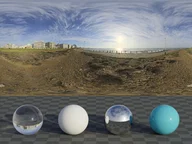</a> <b><a href="furry_clouds">Furry Clouds</a></b> by Greg Zaal, Rico Cilliers · <a href="https://polyhaven.com/a/furry_clouds">source</a> | <a href="golden_bay">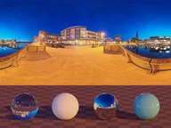</a> <b><a href="golden_bay">Golden Bay</a></b> by Greg Zaal · <a href="https://polyhaven.com/a/golden_bay">source</a> |
| <a href="gray_pier">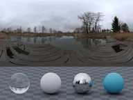</a> <b><a href="gray_pier">Gray Pier</a></b> by Sergey Rudavin · <a href="https://polyhaven.com/a/gray_pier">source</a> | <a href="lake_pier">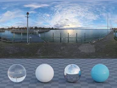</a> <b><a href="lake_pier">Lake Pier</a></b> by Alexander Scholten · <a href="https://polyhaven.com/a/lake_pier">source</a> | <a href="lakes">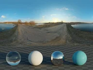</a> <b><a href="lakes">Lakes</a></b> by Sergej Majboroda · <a href="https://polyhaven.com/a/lakes">source</a> | <a href="lakeside">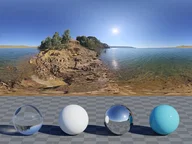</a> <b><a href="lakeside">Lakeside</a></b> by Greg Zaal · <a href="https://polyhaven.com/a/lakeside">source</a> |
| <a href="lakeside_dawn">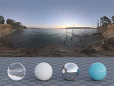</a> <b><a href="lakeside_dawn">Lakeside Dawn</a></b> by Greg Zaal, Jarod Guest · <a href="https://polyhaven.com/a/lakeside_dawn">source</a> | <a href="lakeside_night">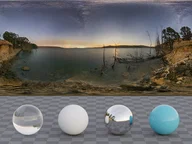</a> <b><a href="lakeside_night">Lakeside Night</a></b> by Greg Zaal, Jarod Guest · <a href="https://polyhaven.com/a/lakeside_night">source</a> | <a href="lakeside_sunrise">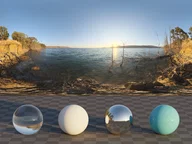</a> <b><a href="lakeside_sunrise">Lakeside Sunrise</a></b> by Greg Zaal, Jarod Guest · <a href="https://polyhaven.com/a/lakeside_sunrise">source</a> | <a href="limehouse">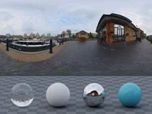</a> <b><a href="limehouse">Limehouse</a></b> by Andreas Mischok · <a href="https://polyhaven.com/a/limehouse">source</a> |
| <a href="modern_buildings">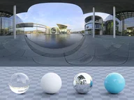</a> <b><a href="modern_buildings">Modern Buildings</a></b> by Greg Zaal · <a href="https://polyhaven.com/a/modern_buildings">source</a> | <a href="monbachtal_riverbank">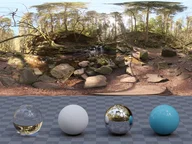</a> <b><a href="monbachtal_riverbank">Monbachtal Riverbank</a></b> by Andreas Mischok · <a href="https://polyhaven.com/a/monbachtal_riverbank">source</a> | <a href="near_the_river_01">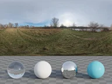</a> <b><a href="near_the_river_01">Near The River 01</a></b> by Sergej Majboroda · <a href="https://polyhaven.com/a/near_the_river_01">source</a> | <a href="near_the_river_02">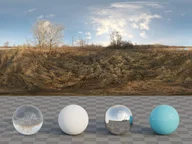</a> <b><a href="near_the_river_02">Near The River 02</a></b> by Sergej Majboroda · <a href="https://polyhaven.com/a/near_the_river_02">source</a> |
| <a href="nkuhlu">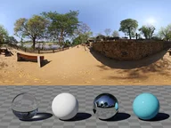</a> <b><a href="nkuhlu">Nkuhlu</a></b> by Greg Zaal · <a href="https://polyhaven.com/a/nkuhlu">source</a> | <a href="nqweba_dawn">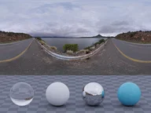</a> <b><a href="nqweba_dawn">Nqweba Dawn</a></b> by Dario Barresi, Jarod Guest · <a href="https://polyhaven.com/a/nqweba_dawn">source</a> | <a href="ouchy_pier">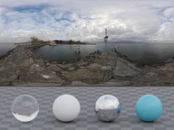</a> <b><a href="ouchy_pier">Ouchy Pier</a></b> by Alexander Scholten · <a href="https://polyhaven.com/a/ouchy_pier">source</a> | <a href="petit_port">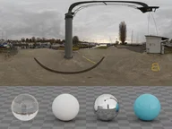</a> <b><a href="petit_port">Petit Port</a></b> by Alexander Scholten · <a href="https://polyhaven.com/a/petit_port">source</a> |
| <a href="pink_sunrise">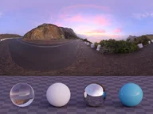</a> <b><a href="pink_sunrise">Pink Sunrise</a></b> by Greg Zaal, Rico Cilliers · <a href="https://polyhaven.com/a/pink_sunrise">source</a> | <a href="poolbeg">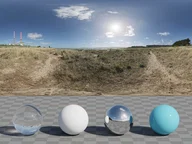</a> <b><a href="poolbeg">Poolbeg</a></b> by Savva Zakharov · <a href="https://polyhaven.com/a/poolbeg">source</a> | <a href="promenade_de_vidy">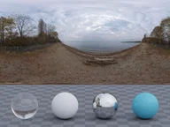</a> <b><a href="promenade_de_vidy">Promenade De Vidy</a></b> by Alexander Scholten · <a href="https://polyhaven.com/a/promenade_de_vidy">source</a> | <a href="quarry_cloudy">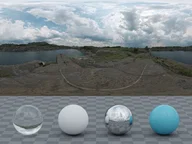</a> <b><a href="quarry_cloudy">Quarry Cloudy</a></b> by Dimitrios Savva, Jarod Guest · <a href="https://polyhaven.com/a/quarry_cloudy">source</a> |
| <a href="radkow_lake">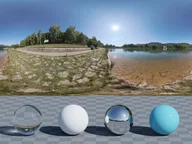</a> <b><a href="radkow_lake">Radkow Lake</a></b> by Grzegorz Wronkowski · <a href="https://polyhaven.com/a/radkow_lake">source</a> | <a href="resting_place">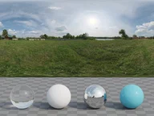</a> <b><a href="resting_place">Resting Place</a></b> by Sergej Majboroda · <a href="https://polyhaven.com/a/resting_place">source</a> | <a href="resting_place_2">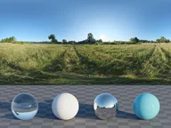</a> <b><a href="resting_place_2">Resting Place 2</a></b> by Sergej Majboroda · <a href="https://polyhaven.com/a/resting_place_2">source</a> | <a href="river_alcove">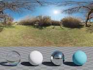</a> <b><a href="river_alcove">River Alcove</a></b> by Dimitrios Savva, Jarod Guest · <a href="https://polyhaven.com/a/river_alcove">source</a> |
| <a href="river_rocks">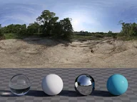</a> <b><a href="river_rocks">River Rocks</a></b> by Greg Zaal · <a href="https://polyhaven.com/a/river_rocks">source</a> | <a href="rural_landscape">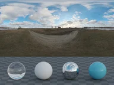</a> <b><a href="rural_landscape">Rural Landscape</a></b> by Sergej Majboroda · <a href="https://polyhaven.com/a/rural_landscape">source</a> | <a href="sandsloot">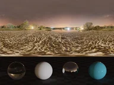</a> <b><a href="sandsloot">Sandsloot</a></b> by Greg Zaal · <a href="https://polyhaven.com/a/sandsloot">source</a> | <a href="secluded_beach">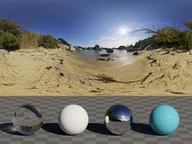</a> <b><a href="secluded_beach">Secluded Beach</a></b> by Greg Zaal, Rico Cilliers · <a href="https://polyhaven.com/a/secluded_beach">source</a> |
| <a href="shanghai_bund">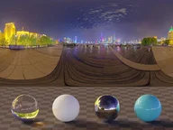</a> <b><a href="shanghai_bund">Shanghai Bund</a></b> by Greg Zaal · <a href="https://polyhaven.com/a/shanghai_bund">source</a> | <a href="shanghai_riverside">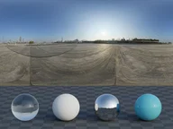</a> <b><a href="shanghai_riverside">Shanghai Riverside</a></b> by Alex Radosnov · <a href="https://polyhaven.com/a/shanghai_riverside">source</a> |  <b><a href="shudu_lake">Shudu Lake</a></b> by Alex Radosnov · <a href="https://polyhaven.com/a/shudu_lake">source</a> |  <b><a href="simons_town_harbour">Simon's Town Harbour</a></b> by Greg Zaal, Rico Cilliers · <a href="https://polyhaven.com/a/simons_town_harbour">source</a> |
|  <b><a href="simons_town_rocks">Simon's Town Rocks</a></b> by Greg Zaal, Rico Cilliers · <a href="https://polyhaven.com/a/simons_town_rocks">source</a> |  <b><a href="small_harbor_01">Small Harbor 01</a></b> by Greg Zaal · <a href="https://polyhaven.com/a/small_harbor_01">source</a> |  <b><a href="small_harbor_02">Small Harbor 02</a></b> by Greg Zaal · <a href="https://polyhaven.com/a/small_harbor_02">source</a> |  <b><a href="small_harbour_morning">Small Harbour Morning</a></b> by Greg Zaal, Jarod Guest · <a href="https://polyhaven.com/a/small_harbour_morning">source</a> |
|  <b><a href="small_harbour_sunset">Small Harbour Sunset</a></b> by Greg Zaal, Jarod Guest · <a href="https://polyhaven.com/a/small_harbour_sunset">source</a> |  <b><a href="spiaggia_di_mondello">Spiaggia di Mondello</a></b> by Andreas Mischok · <a href="https://polyhaven.com/a/spiaggia_di_mondello">source</a> |  <b><a href="spree_bank">Spree Bank</a></b> by Alexander Scholten · <a href="https://polyhaven.com/a/spree_bank">source</a> |  <b><a href="spruit_dawn">Spruit Dawn</a></b> by Greg Zaal · <a href="https://polyhaven.com/a/spruit_dawn">source</a> |
|  <b><a href="sundowner_overlook">Sundowner Overlook</a></b> by Dario Barresi · <a href="https://polyhaven.com/a/sundowner_overlook">source</a> |  <b><a href="the_sky_is_on_fire">The Sky Is On Fire</a></b> by Greg Zaal, Rico Cilliers · <a href="https://polyhaven.com/a/the_sky_is_on_fire">source</a> |  <b><a href="tiber_2">Tiber 2</a></b> by Greg Zaal, Rico Cilliers · <a href="https://polyhaven.com/a/tiber_2">source</a> |  <b><a href="tiber_island">Tiber Island</a></b> by Greg Zaal, Rico Cilliers · <a href="https://polyhaven.com/a/tiber_island">source</a> |
|  <b><a href="tucker_wreck">Tucker Wreck</a></b> by Greg Zaal, Rico Cilliers · <a href="https://polyhaven.com/a/tucker_wreck">source</a> |  <b><a href="umhlanga_sunrise">Umhlanga Sunrise</a></b> by Greg Zaal · <a href="https://polyhaven.com/a/umhlanga_sunrise">source</a> |  <b><a href="venice_sunset">Venice Sunset</a></b> by Greg Zaal · <a href="https://polyhaven.com/a/venice_sunset">source</a> |  <b><a href="white_cliff_top">White Cliff Top</a></b> by Greg Zaal, Rico Cilliers · <a href="https://polyhaven.com/a/white_cliff_top">source</a> |
|  <b><a href="winter_lake_01">Winter Lake 01</a></b> by Sergej Majboroda · <a href="https://polyhaven.com/a/winter_lake_01">source</a> |  <b><a href="winter_river">Winter River</a></b> by Sergej Majboroda · <a href="https://polyhaven.com/a/winter_river">source</a> |  <b><a href="winter_sky">Winter Sky</a></b> by Greg Zaal · <a href="https://polyhaven.com/a/winter_sky">source</a> |  |

---

Updated automatically by [cc0-mirror](https://github.com/zuujis-cc0/cc0-mirror). Something wrong? [Open an issue there](https://github.com/zuujis-cc0/cc0-mirror/issues/new) or use the [private report form](https://games.zuujis.com/report).
